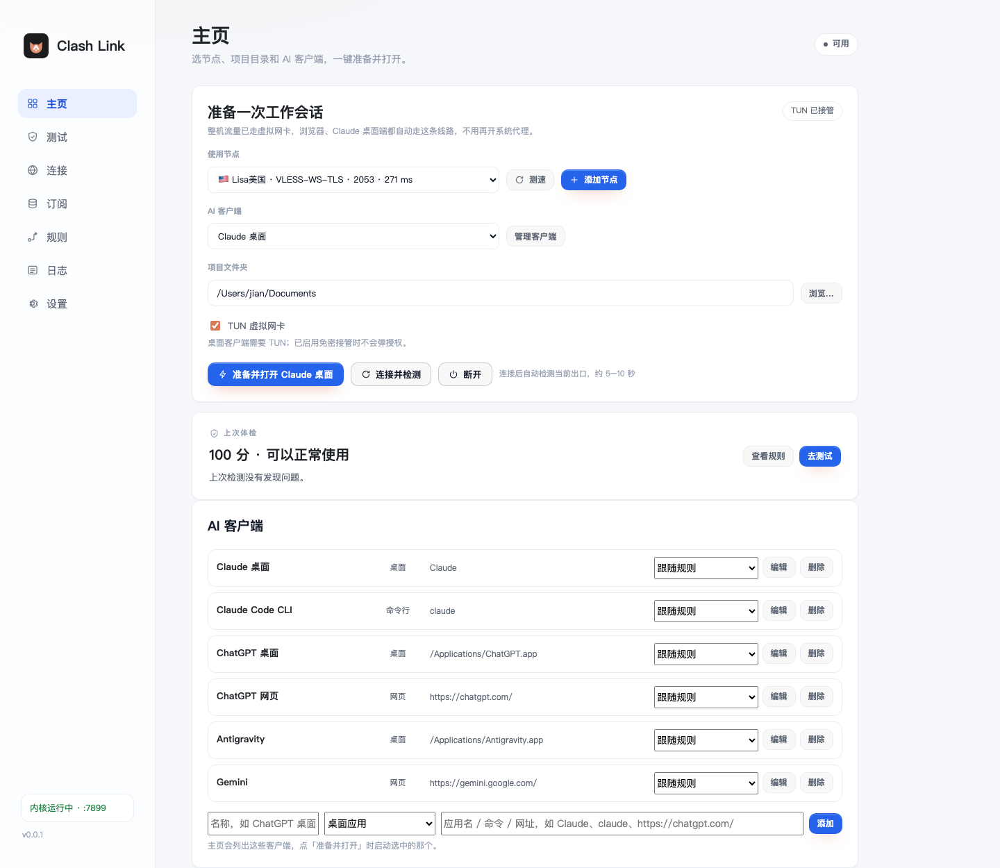

# Clash Link · 海外 AI 网络体检

一个 macOS 上的本地小工具：**自动检测本机网络能否正常使用 Claude（网页版 / Claude Code / API）**，并把系统时区一键同步成机场出口节点所在的时区。名字叫 Clash Link，覆盖 Claude / ChatGPT / Gemini / Grok / Perplexity / Copilot 等海外 AI 服务。



- 纯 Python 标准库实现，**不需要 pip 安装任何依赖**。
- 当前版本 **0.0.1**。前身依次是 Claude 网络体检 / ClaudeNetGuard → AIReady → AIClash → **Clash Link**；旧数据会自动迁移到 `~/Library/Application Support/ClashLink`。
- 顺手支持**切换内核节点并自动复测**：在页面里点节点即可换线，换完自动重跑体检。
- 检测结果只保存在本机，控制台只监听 `127.0.0.1`，不对外暴露端口。
- 时区同步通过 macOS 官方 `systemsetup` 完成，**会请求一次管理员授权**，不写系统文件、不改 SIP。

---

## 快速开始

### 方式一：双击 App（推荐）

```
dist/Clash Link.app
```

双击后是一个独立的应用窗口（原生 WKWebView 外壳，不会打开 Safari / Chrome）。首次打开如果提示「无法验证开发者」，右键点击 App → **打开** → 再确认一次即可（本工具是 ad-hoc 签名，没有 Apple 公证）。

> App 自带 CPython 3.12 运行时（`Contents/Resources/python`），**不需要本机安装 Python**；只有命令行方式才需要系统 `python3`。

### 方式二：命令行

```bash
cd "claude proxy"
python3 -m claudenet.app            # 开发用：起控制台并开浏览器（默认 8788）
python3 -m claudenet.app --port 9000 --no-browser
```

### 方式三：终端体检（无界面）

```bash
python3 -m claudenet check          # 完整体检，彩色表格
python3 -m claudenet check --json   # 机器可读
python3 -m claudenet status         # 看系统时区与上次结论
python3 -m claudenet fix            # 把系统时区同步到出口时区
python3 -m claudenet serve          # 只启动控制台
```

---

## 界面能做什么

| 区域 | 说明 |
| --- | --- |
| 顶部状态 | 当前结论（正常 / 有风险 / 不可用）、重新检测 |
| 分数环 | 0–100 体检分，颜色对应结论 |
| 出口节点卡 | 出口 IP、国家/城市、ASN、Cloudflare 边缘节点、是否走 TUN |
| 时区卡 | 系统时区 vs 出口时区、两边当前时间、偏移差；偏移不一致时才允许「一键同步」 |
| 启动前检查 | 19 项检查按四组排列（出口与代理 / Claude 连通性 / 其他 AI 服务 / 环境一致性），带状态、说明、耗时 |
| 订阅管理 | 工具栏（添加 / 更新选中 / 编辑 / 删除）+ 订阅卡（节点数、已用流量、到期、更新时间）+ 启用/使用中 + TUN 与系统代理 |
| 节点管理 | 列出内核里的节点组，可测速、点一下就切节点；与首页下拉双向同步，切换后自动复测 |
| 自动跟随 | 打开后，按设定间隔（默认 120 秒）复查；发现时区漂移会自动同步 |

「一键同步」会先弹确认框，说明接下来会请求管理员授权；确认后执行：

```bash
sudo systemsetup -settimezone America/Los_Angeles
```

失败时界面会显示原因（例如取消授权、时区名无效）。也可以点「复制命令」自己到终端执行。

---

## 检测项

除了 Claude 的三条链路，还会探测 6 个海外 AI 服务的 API 是否可达（未带 Key 返回 401/403 也算通）：

| 服务 | 探测地址 |
| --- | --- |
| OpenAI / ChatGPT | `api.openai.com/v1/models` |
| Google Gemini | `generativelanguage.googleapis.com` |
| xAI Grok | `api.x.ai/v1/models` |
| Perplexity | `api.perplexity.ai/chat/completions` |
| Mistral | `api.mistral.ai/v1/models` |
| GitHub Copilot | `api.githubcopilot.com/models` |


| ID | 检查 | 说明 | 关键项 |
| --- | --- | --- | --- |
| proxy | 代理链路 | 环境变量 / 系统代理 / Clash 常见端口 / TUN 是否接管 | |
| exit | 出口节点 | 出口 IP、国家、城市、ASN、Cloudflare colo | |
| dns | DNS 解析 | 是否 fake-ip 接管、`claude.ai` 解析结果 | |
| api | Anthropic API | `GET /v1/models` 能拿到 401（未带 Key 属正常） | ✅ |
| web | Claude 网页版 | `claude.ai` 是否可访问（区分 Cloudflare 挑战与地区封锁） | |
| console | Console 控制台 | `console.anthropic.com` 可达性 | |
| statsig | Statsig 遥测 | `statsig.anthropic.com` TLS 握手（影响 Claude Code 功能开关/遥测） | |
| tls | TLS 与证书 | 握手耗时、TLS 版本、证书签发者、有效期 | ✅ |
| latency | 链路延迟 | 三次采样取中位数，>2000 ms 视为首字延迟明显 | |
| region | 地区可用性 | 出口国家是否属于 Anthropic 支持地区 | ✅ |
| timezone | 时区一致性 | 系统时区与出口时区的偏移差 | |
| clock | 系统时钟 | 本机时间与服务端 `Date` 头的偏差 | |
| local | 本地客户端 | Node / Claude Code / Claude 桌面版是否已安装 | |

### 评分规则

- 初始 100 分；`fail` 关键项 −26、普通项 −14；`warn` −8。
- 关键项失败或分数 < 55 → **不可用**；有 `warn` 或分数 < 92 → **有风险**；否则 **正常**。
- `info` 项（本地客户端）只展示，不扣分。

### 已知的「假故障」

- **Statsig 遥测失败**：不少机场节点会阻断 `statsig.anthropic.com`，表现为 TLS 握手被中断（`SSLEOFError`）。它不影响网页版，但可能让 Claude Code 的功能开关/遥测异常，因此记为 `warn` 而不是 `fail`。
- **Cloudflare 挑战**：用 curl 默认 UA 请求 `claude.ai` 会得到 403 + `cf-mitigated: challenge`，这并不等于被地区封锁；本工具用浏览器 UA 与 `Sec-Fetch-*` 头复测，能 302 就判定通过。
- **API 401**：`api.anthropic.com` 未带 Key 返回 401 是**预期结果**，说明链路与地区都正常。

---

## 时区同步是怎么工作的

1. 用出口 IP 查询地理信息（ipwho.is → api.ipapi.is → ipapi.co 依次回退），拿到出口时区名（如 `America/Los_Angeles`）。
2. 读本机时区（`/etc/localtime` 的软链，避免 `systemsetup -gettimezone` 也要管理员权限）。
3. 计算两边 UTC 偏移差；名称相同或偏移相同都视为一致。
4. 需要同步时，通过 AppleScript 以管理员权限执行 `systemsetup -settimezone <tz>`。

**时区同步本身不会切换节点、不会改代理配置。** 自动跟随只在你打开开关后才生效；每次自动同步仍会弹一次管理员授权，这是 macOS 的限制。

---

## 界面

左侧是导航，一共五页：

| 页面 | 做什么 |
| --- | --- |
| 代理 | 运行模式（规则/全局/直连）、代理组、实时流量曲线、连接列表、内核日志 |
| 首页 | 准备工作会话：选节点、决定是否接管系统代理、开始会话并检测、断开、打开 Claude 桌面端；下面是结论、时区对照和四个状态卡 |
| 线路节点 | 节点卡片：地区、协议、端口、延迟；点卡片即切换，「切到最快」按延迟排序 |
| 订阅管理 | 工具栏（添加 / 更新选中 / 编辑 / 删除）+ 订阅卡（节点数、已用流量、到期、更新时间）+ 启用/使用中 + TUN 与系统代理 |
| 环境设置 | 巡检间隔、界面主题、数据目录 |
| 运行记录 | 最近 30 次检测的分数、出口与注意项 |

## TUN 模式（可选）

「机场订阅」页底部可以打开 **TUN 模式**：内核会创建虚拟网卡（`198.18.0.1`）接管整机流量，适合 Claude 桌面端、命令行工具这类不走系统代理的程序。开启需要管理员授权，内核由 launchd 以 root 拉起，不依赖应用进程存活。

实测：开启后系统代理是关的，`curl https://claude.ai/cdn-cgi/trace` 直接得到 `ip=192.220.58.15 colo=LAX`，YouTube 也正常。关闭开关会移除 launchd 任务并重启成普通内核，再点「接管系统代理」就能回到原来的模式。

开着 TUN 时不要再开 Clash Verge 的 TUN；如果网络异常，关掉开关即可回退。

## 订阅流量与到期

如果机场在订阅响应里返回 `subscription-userinfo` 头，订阅卡片会显示已用 / 总量、进度条、剩余、到期与更新时间；只返回 used 不返回 total 时显示「配额未知」；都没有就只显示节点数与更新时间。

## 临时设置与恢复

接管系统代理前会记录一份原始代理配置（服务名、HTTP/HTTPS/SOCKS、bypass 列表）。点「断开」或退出应用时会按这份记录还原，而不是一律关掉。「环境设置 → 本次会话」里能看到接管、改时区、启停内核的记录，也有一个「恢复临时设置」按钮一次性还原并停掉内核。

## 免密接管（可选）

环境设置 ›「免密接管网络」点一次「启用」，会弹出**一次**管理员授权，写入三样东西：

- `/etc/sudoers.d/claudenet-tz`：只放开 `systemsetup` 读写时区、`networksetup` 改代理、以及 `/usr/local/bin/claudenet-tun`
- `/usr/local/bin/claudenet-tun`：只做 `launchctl kickstart/kill system/io.claudenet.core`
- `/Library/LaunchDaemons/io.claudenet.core.plist`：TUN 内核用 root 跑

之后改时区、跟随节点、切换系统代理、开关 TUN 都不再弹密码（实测改时区 0.09 s、代理 0.4 s、TUN 开关 0.5–7 s）。

## 主题

右上角的按钮循环切换 **深色 / 浅色 / 自动**（自动跟随 macOS 外观），选择会写进 `settings.json`，下次打开保持。
也可以临时用 `?theme=light` 预览。

## 机场订阅与节点

工具自带一个 mihomo 内核进程，可以直接吃机场订阅，不需要你去 Clash Verge 开外部控制器。

1. 在「订阅管理」里粘贴订阅链接（`https://…/api/v1/client/subscribe?token=…`），点 **添加**。如果当前内核没在跑，添加成功后会自动启用这条订阅。
   添加失败时，输入框下方会用红字写明原因（HTTP 状态、超时、格式不识别等），不是只闪一下。
2. 点 **启用**：程序用订阅配置在 `127.0.0.1:7899` 起一个独立的 mihomo，控制端口 `127.0.0.1:9096`。
3. 「线路节点」面板会列出订阅里的分组和节点，点节点即可切换，切换后自动复测。
4. 需要让浏览器、Claude 桌面端也走这个内核时，点 **接管系统代理**（会请求一次管理员密码，把 Wi-Fi 的 HTTP/HTTPS/SOCKS 代理指向 `127.0.0.1:7899`）；再点一次恢复。

说明：

- 支持 Clash / mihomo 配置格式（`proxies` + `proxy-groups` + `rules`），也支持 base64 节点链接（`ss://` `trojan://` `vmess://` `vless://` `hysteria2://`）。
- 内核二进制打在 App 包里（`Contents/Resources/bin/mihomo`，约 54 MB，GPL-3.0，来源与版本见同目录 `NOTICE-mihomo.txt`）；也可以用 `AIREADY_MIHOMO` 指向别的 mihomo。运行时也随包携带，App 约 143 MB，zip 约 41 MB。
- 启用订阅后，体检会自动走这个内核，切节点 → 复测能直接反映新线路。
- 订阅里带的 `tun` / `dns` / 端口配置会被忽略，避免和 Clash Verge 抢 TUN 与 53 端口。
- 若同时开着 Clash Verge 的 TUN，请先关掉它再「接管系统代理」，否则两套内核会打架。
- 不接管系统代理时，它只负责「切节点 + 体检」，不会动你现有的网络设置。

## 常见问题

### 节点延迟为什么是 200–900 ms

节点右侧的数字由 mihomo 测量 `gstatic.com/generate_204`，并开启了 `unified-delay`（和 Clash Verge 一致）：会先测出一次纯网络往返，再折算掉各协议多出来的握手轮次，所以 Trojan/VLESS 和 Hysteria2 可以直接横向比较。机场落地在洛杉矶时，这个数字通常落在 180–280 ms，也就是单程 RTT 的两倍左右。实际 claude.ai 首字节约 0.4–0.5 s。


**双击没反应？**
看日志：`~/Library/Logs/Clash Link.log`。常见原因是 8788 端口被占用（工具会自动换端口），或内核二进制缺失。

**端口被占用？**
默认 8788，被占用时会自动顺延到 8789、8790…；如果检测到已有实例在跑，会直接打开已有页面，不会重复启动。

**识别不到我的代理？**
支持环境变量（`HTTPS_PROXY` 等）、macOS 系统代理、TUN、以及 Clash/Surge/V2Ray 的常见本地端口（7897/7890/7891/1087/1080/6152/8888/8080）。SOCKS5 目前不支持，请使用 HTTP mixed-port。也可以手动指定：`HTTPS_PROXY=http://127.0.0.1:7897 python3 -m claudenet check`。

**时区同步失败？**
- 在弹窗里点了「取消」→ 重新点一次「一键同步」。
- 时区名无效（出口 IP 库返回了奇怪的值）→ 用「复制命令」手动执行，或换一个节点再检测。
- 公司电脑禁用了 `systemsetup` / 远程管理 → 只能手动在「系统设置 → 通用 → 日期与时间」里改。

**双击提示「已损坏，应移到废纸篓」？**
这是 macOS 对「从网上下载、又没做公证」的 App 的拦截，不是文件真的坏了。任选一种：

- 右键点 App → **打开** → 再点「打开」；
- 或者执行一次：`xattr -dr com.apple.quarantine "/Applications/Clash Link.app"`（把路径换成实际位置）。

1.1.1 起已修掉一个会导致该提示的真问题：Python 运行时会往 App 包里写 `__pycache__`，破坏代码签名；现在启动脚本固定带 `-B`，不再写入。

**还需要安装 Clash Verge 吗？**
不需要。mihomo 内核已经打进 App（`Contents/Resources/bin/mihomo`），订阅、节点、TUN 全部自带；删掉 Clash Verge 也能用。想换内核时用 `AIREADY_MIHOMO` 指定路径即可。

**分数多少算正常？**
≥ 92 为正常；76–91 通常只是 Statsig/时区之类可处理项；关键项失败才是真的用不了。

---

## 数据与隐私

- 配置与历史报告：`~/Library/Application Support/ClashLink/`（`settings.json`、`last-report.json`）。
- 运行日志：`~/Library/Logs/Clash Link.log`。
- 出网请求只用于检测：`claude.ai/cdn-cgi/trace`、`api.anthropic.com`、`console.anthropic.com`、`statsig.anthropic.com`、IP 地理库。不上传任何本地数据。
- 控制台只绑定 `127.0.0.1`，并校验 `Host` 头，防止 DNS rebinding 访问。

---

## 从源码构建

`tools/runtime/`（内置 CPython 3.12）没有进仓库，构建前先准备：

```bash
mkdir -p tools/runtime
curl -L -o /tmp/py.tar.gz https://github.com/astral-sh/python-build-standalone/releases/download/20261110/cpython-3.12.16+20261110-aarch64-apple-darwin-install_only_stripped.tar.gz
tar -xzf /tmp/py.tar.gz -C tools/runtime
python3 tools/build_app.py
```

生成物在 `dist/Clash Link.app`，`ditto` 打包即可。

## 开发

```
claudenet/
  net.py        代理发现、HTTP 请求、TLS 探测
  geo.py        出口 IP 地理信息与地区判断
  timezone.py   时区读取/比较/修改
  checks.py     13 项基础检查 + 6 个海外 AI 服务、并发调度、评分
  store.py      设置与历史报告持久化
  server.py     本地 HTTP API + 静态页面
  app.py        桌面启动器（开浏览器）
  cli.py        命令行入口
  web/          index.html / styles.css / app.js
tools/
  build_app.py  打包 .app（Info.plist + 启动器 + 图标）
  icon.svg      图标源文件
tests/
  test_claudenet.py
```

```bash
python3 -m unittest discover -s tests -v   # 单元测试（不联网）
python3 tools/build_app.py                 # 重新打包 App
node --check claudenet/web/app.js          # 前端语法检查
```

前端没有构建步骤，改完 `web/` 刷新页面即可；截图调试可加 `?noauto=1` 只看上次结果。

---

## 免责声明

本工具只做本机网络探测与时区设置，不提供任何代理/VPN 服务，也不绕过任何服务条款。请遵守 Anthropic 的使用政策与所在地法律法规。
